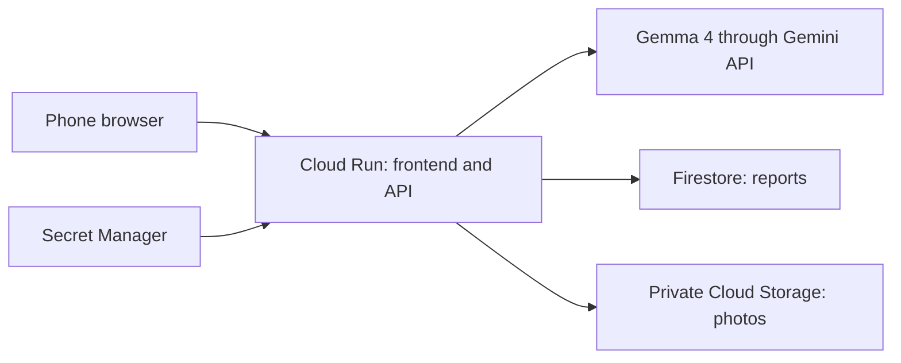

# FixProof

Photo-based repair documentation for renters.

Status: hackathon build in progress

## What it does <!-- owner: shared -->

## Demo <!-- owner: shared -->

## Usage <!-- owner: friend -->

## Accessibility <!-- owner: friend -->

## Personas, composites <!-- owner: friend -->

## Impact <!-- owner: friend -->

## Architecture <!-- owner: Sid -->

The phone browser, frontend, and API share one Cloud Run address. See [the architecture and data model](docs/ARCHITECTURE.md).



## Model and license <!-- owner: Sid -->

The selected model is `gemma-4-26b-a4b-it`, accessed through the Gemini API. The first real model request is pending.

- [Google's Gemma API guide](https://ai.google.dev/gemma/docs/core/gemma_on_gemini_api)
- [Model card](https://ai.google.dev/gemma/docs/core/model_card_4) and [Apache 2.0 model license](https://www.apache.org/licenses/LICENSE-2.0)
- [Hosted Gemini API terms](https://ai.google.dev/gemini-api/terms)

Model output is checked against the API schema. Invalid output gets one correction attempt. A schema check does not prove that an observation is accurate. Users must review the draft.

## Setup <!-- owner: Sid -->

Use Node 20.19 or later within Node 20, and npm. The frontend belongs to the separate `web/` lane.

```sh
git clone https://github.com/siddprat/fixproof.git
cd fixproof
npm ci --prefix api
npm ci --prefix web
cp .env.example .env
```

Fill the root `.env` with `GOOGLE_CLOUD_PROJECT`, `GCS_BUCKET`, and `GEMMA_MODEL=gemma-4-26b-a4b-it`. Set `AI_MODE=hosted` and `MOCK_AI=1` for canned model results. Remove optional blank variables or fill them in. Do not commit `.env`.

For real Google storage on your laptop, run `gcloud auth application-default login`. This is separate from `gcloud auth login`. The signed-in account needs access to Firestore and the bucket.

```sh
npm run dev --prefix api
```

In another Terminal:

```sh
VITE_USE_MOCK=false npm run dev --prefix web
```

`MOCK_AI=1` replaces only model calls. Storage is still real. The default canned result is the hazard example. Notes containing `[mock:blurry]` or `[mock:unrelated]` select other fixtures. These are test results, not photo assessments. `VITE_USE_MOCK=true` instead runs the frontend's in-browser fixtures without an API.

For real inference, set `MOCK_AI=0` and supply `GEMINI_API_KEY` in the root `.env` or process environment. To test one photo:

```sh
cd api
npm run try-analyze -- /absolute/path/to/photo.jpg
```

For optional local inference, set `AI_MODE=local`, `OLLAMA_URL=http://localhost:11434`, and `OLLAMA_MODEL` to an installed image-capable model. Local inference has not yet been tested on a laptop. Cloud storage is still used.

```sh
npm run build --prefix api
npm test --prefix api
```

## Deploy to Google Cloud <!-- owner: Sid -->

Project: `fixproof-512621`. Region: `us-east1`. The initial health-only deploy succeeded. The full app deploy and real-model smoke check remain pending.

Services enabled: Cloud Run, Cloud Build, Artifact Registry, Firestore, Cloud Storage, and Secret Manager. Firestore uses native mode. The bucket `fixproof-512621-fixproof-photos` was created with uniform access and public access prevention.

From the repository root:

```sh
bash scripts/deploy.sh
```

The script pulls and pushes main, builds and tests the API, creates a dedicated app identity if needed, privately asks for a key only if no secret exists, and deploys the Dockerfile. The Dockerfile builds both the frontend and API. It sets `VITE_USE_MOCK=false` for the hosted frontend. Deployment uses a maximum of two instances, 512 MiB memory, concurrency one, and a 60-second request timeout. The key comes from Secret Manager. After deployment, the script runs a generated-image smoke check and deletes its own test case.

To check a real housing photo through the deployed API:

```sh
npm run smoke --prefix api -- https://fixproof-774631300212.us-east1.run.app /absolute/path/to/photo.jpg
```

This uploads the chosen photo, checks the report, edits it, requests an email if it shows a housing concern, verifies hashes, and deletes the test case. It does not send email.

## Privacy and data flow <!-- owner: Sid -->

Hosted mode sends processed photos and notes to Google through the Gemini API. It is not private local processing. Stored photos are resized JPEGs with GPS and other metadata removed. Firestore stores notes, server times, unverified camera times, analysis, and photo hashes. Cloud Storage stores the processed images.

There are no accounts, analytics, or email sending. The case ID is the only access key. Keep links and local browser storage private. Anyone with a case ID can read or delete that case.

Delete my case removes its Firestore records and stored photos. This does not erase infrastructure request logs or promise deletion of data retained by an AI provider. Optional Ollama inference avoids sending inputs to the Gemini API; storage in this deployment still uses Google Cloud.

Records are timestamped and verifiable. A hash detects changes to stored bytes. It does not prove when a photo was taken, what it shows, or who took it.

## Known limits <!-- owner: shared -->

## License <!-- owner: Sid -->

FixProof code is available under the [MIT license](LICENSE). The model and hosted service have their own license and terms, linked above.
