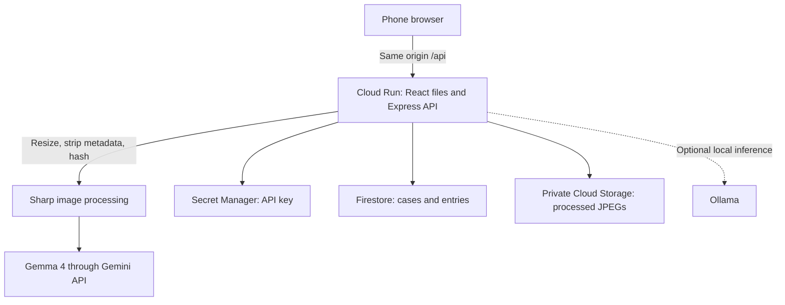

# Architecture

Cloud Run serves the frontend and API at one address. Firestore stores small report records. Cloud Storage holds processed images in a private bucket. Secret Manager supplies the model key to the app's service account.

## Data

- `cases/{caseId}` stores the server creation time and a short-lived write lease.
- `cases/{caseId}/entries/{entryId}` stores the contract Entry, including observations, note, dates, and photo hashes.
- `cases/{caseId}/{entryId}/{photoId}.jpg` holds each processed photo.
- IDs are random UUID v4 values. The case ID is the only access key. Anyone with it can read, edit, or delete that case.

Analysis finishes before any photo or entry is stored. Case writes use a Firestore lease to serialize uploads, edits, and deletion across instances. Failed writes clean up uploaded files when the entry was not saved. Deletion marks a case unavailable, removes files and entries, checks that they are gone, then removes the case document. A failed deletion can be retried.

## Boundaries

Original photos are decoded in memory. Only resized JPEGs are stored and sent to the hosted model. Stored images have no EXIF or GPS metadata. The original camera time is an unverified field in the entry. The SHA-256 covers the exact stored bytes. Verification detects changes to those bytes; it does not prove what a photo shows.

Hosted inference sends processed photos and notes to Google through the Gemini API. Email generation sends selected observations, dates, location, category, and optional names and unit. Names are used for the draft and are not saved by the API. Ollama avoids sending inference inputs to the Gemini API, but this deployment still uses Google Cloud for storage. End-to-end offline storage is not implemented.

Rate limits use per-instance memory. Analysis and email share a limit of 30 requests per IP per hour on each instance. With two instances, this is not a strict project-wide cost cap. No application analytics or tracking are added. Google Cloud infrastructure logs and provider retention are separate from case deletion.
